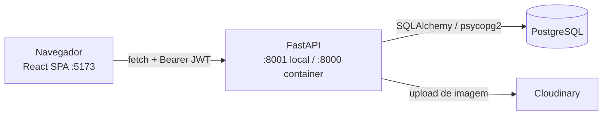
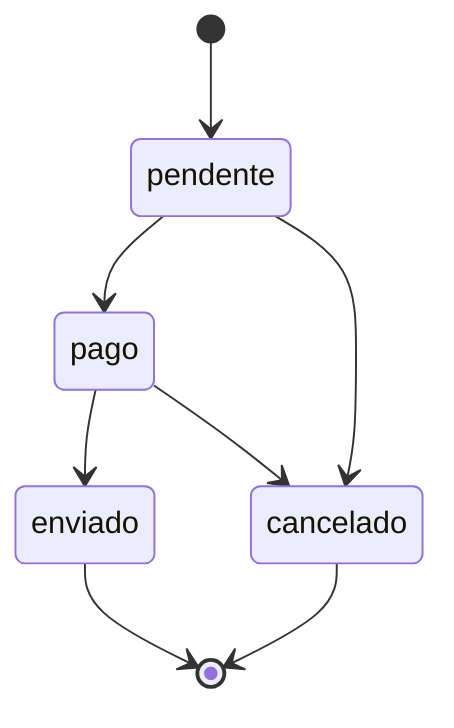

# Arquitetura

Voltar: [Home](Home.md) · Ver também: [API](API.md), [Database](Database.md)

## Visão geral

## Backend (`backend/app`)

| Módulo | Responsabilidade |
|--------|------------------|
| `main.py` | Cria o `FastAPI`, configura CORS (`http://localhost:5173`, `http://127.0.0.1:5173`) e inclui os routers |
| `core/config.py` | Lê variáveis de ambiente (`python-dotenv`), exige `SECRET_KEY` e monta `DATABASE_URL` |
| `core/database.py` | `engine`, `SessionLocal`, `Base` (DeclarativeBase) |
| `core/security.py` | Hash/verificação de senha (bcrypt) e criação/decodificação de JWT (expira em 60 min) |
| `core/cloudinary.py` | Chama `cloudinary.config(...)`, mas não é importado por nenhum módulo; na prática o SDK lê as variáveis `CLOUDINARY_*` do ambiente sozinho |
| `dependencies.py` | `get_db`, `obter_usuario_atual` (HTTPBearer), `exigir_admin` |
| `models/` | Modelos ORM: `Usuario`, `Produto`, `Pedido`, `ItemPedido`, enum `StatusPedido` |
| `schemas/` | Schemas Pydantic de entrada (produto, usuário, pedido) |
| `routers/` | `auth`, `produtos`, `pedidos`, `usuarios` — ver [API](API.md) |
| `services/pedido_service.py` | Regras de pedido: estoque, total, transições de status, devolução de estoque no cancelamento |

Padrões observados:
- Routers tratam `OperationalError` com `rollback` e respondem 500; erros de negócio usam `HTTPException`. `IntegrityError` é convertido em 409 onde há conflito esperado (e-mail duplicado, exclusão de produto com pedidos).
- Somente pedidos têm camada de serviço; produtos e usuários têm a lógica no router.
- Respostas são `dict` ou objetos ORM; não há `response_model` declarado nos routers (`ProdutoResponse` existe em `schemas/produto.py` mas não é usado).

### Regras de pedido

Implementadas em `services/pedido_service.py`.

- Criar pedido agrupa itens repetidos do mesmo produto, trava a linha do produto (`SELECT ... FOR UPDATE`), valida existência (404) e estoque (400), grava `preco_unitario` do momento, calcula `total` e baixa o estoque.
- Mudar para `cancelado` devolve ao estoque a quantidade de cada item.

## Frontend (`frontend/src`)

| Pasta | Responsabilidade |
|-------|------------------|
| `App.jsx` | Rotas (`BrowserRouter`) e provedores de autenticação e carrinho |
| `services/api.js` | `requisitar()` — wrapper de `fetch`, base `VITE_API_URL` ou `http://localhost:8001`, injeta Bearer e traduz erros 422 |
| `services/*Service.js` | Chamadas por recurso (autenticação, produtos, pedidos, usuários) |
| `context/` | `contextos.js` (objetos de contexto), `AuthContext` (token e usuário em `localStorage`) e `CartContext` (carrinho em `localStorage`, chave `@WhitePony:carrinho`) |
| `hooks/` | Hooks de dados e formulário (`useProdutos`, `useMeusPedidos`, `usePedidosAdmin`, ...). Hooks de carregamento atualizam o estado só nos callbacks da requisição e recarregam incrementando uma `versao` |
| `pages/` | Home, Login, Cadastro, Produto, Carrinho, MeusPedidos, Perfil, Configuracoes, Admin |
| `components/` | Componentes por domínio (admin, carrinho, produtos, pedidos, header, comuns, rotas) |
| `styles/tokens.css` | Tokens de design |

Rotas da SPA: `/`, `/login`, `/cadastro`, `/produto/:id`, `/carrinho`, `/pedidos`*, `/perfil`*, `/configuracoes`*, `/admin`** (\* `RotaProtegida`; \*\* `RotaProtegida somenteAdmin`).

## Infraestrutura

- `backend/Dockerfile`: Python 3.13-slim, `uvicorn` na porta 8000.
- `backend/docker-compose.yml`: serviço `database` (postgres:18-alpine, host `5433`) e `api` (host `8001`). Execução completa: **Not verified**.
- Sem CI configurado no repositório (nenhum workflow encontrado).

## Testes

- Backend: `backend/tests` — `conftest.py` exige `DATABASE_URL_TESTE` terminando em `_test` e faz `create_all`/`drop_all` por teste em Postgres real. Arquivos: `test_auth`, `test_produtos`, `test_pedidos`, `test_usuarios`, `test_estrutura`.
- Frontend: Vitest + Testing Library + jsdom (`vite.config.js`, `src/test/setup.js`); testes em `pages/produto/Produto.test.jsx` e `hooks/hooks.test.jsx`. `npm run lint` deve passar sem erros.
