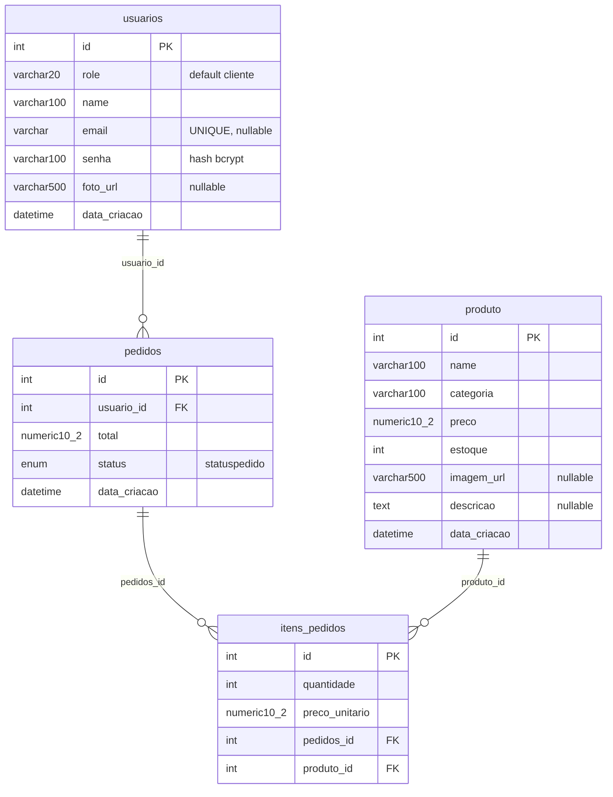

# Banco de dados

Voltar: [Home](Home.md) · Ver também: [Architecture](Architecture.md), [Setup](Setup.md)

PostgreSQL acessado via SQLAlchemy 2.x (`psycopg2`). Modelos em `backend/app/models/`, migrações Alembic em `backend/alembic/versions/`.

## Diagrama

## Observações

- A tabela de produtos se chama `produto` (singular); as demais estão no plural.
- `role`: `"cliente"` (padrão) ou `"admin"`. Não há endpoint para promover admin — feito direto no banco (**Not verified** qual procedimento é usado).
- `status` é o enum Postgres `statuspedido`; o banco guarda os **nomes** (`PENDENTE`, `PAGO`, `ENVIADO`, `CANCELADO`) e a API expõe os **valores** em minúsculas.
- `preco_unitario` congela o preço do produto no momento do pedido.
- Não há `ON DELETE CASCADE`: excluir um produto referenciado por `itens_pedidos` viola a FK e a API responde 409, preservando o histórico de pedidos.
- `data_criacao` usa `datetime.now` (horário local, sem timezone).

## Migrações (Alembic)

Cadeia linear, `env.py` usa `DATABASE_URL` de `app.core.config` e `Base.metadata` para autogenerate.

| Revisão | Descrição |
|---------|-----------|
| `26dc11b4a7ed` | Criação inicial: `produto`, `usuarios`, `pedidos`, `itens_pedidos` |
| `e348e7211928` | Adiciona `produto.imagem_url` |
| `a7c3f1d92b44` | Adiciona `produto.descricao` |
| `c4e9b2a7d158` (head) | Adiciona `usuarios.foto_url` |

Comandos (em `backend/`): `alembic upgrade head`, `alembic revision --autogenerate -m "<descricao>"`.

## Regras de segurança

- Depois de atualizar o código, rode `alembic upgrade head`: sem as migrações novas a API responde 500 nas rotas que usam colunas novas.
- Banco de aplicação local deve ser tratado como produção: nunca rodar testes destrutivos nem `drop`/`downgrade` nele.
- Testes usam banco separado via `DATABASE_URL_TESTE` (nome obrigatoriamente terminado em `_test`); o `conftest.py` cria e apaga todas as tabelas a cada teste.
- Toda mudança de modelo exige migração nova e atualização desta nota.
